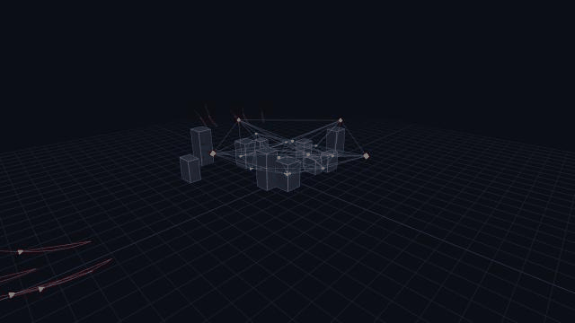
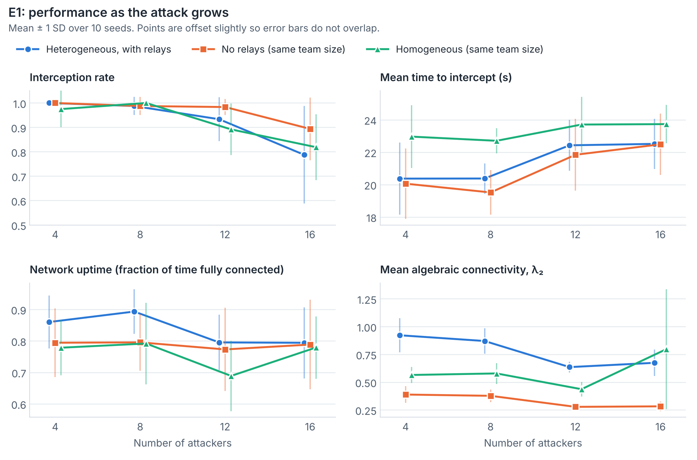
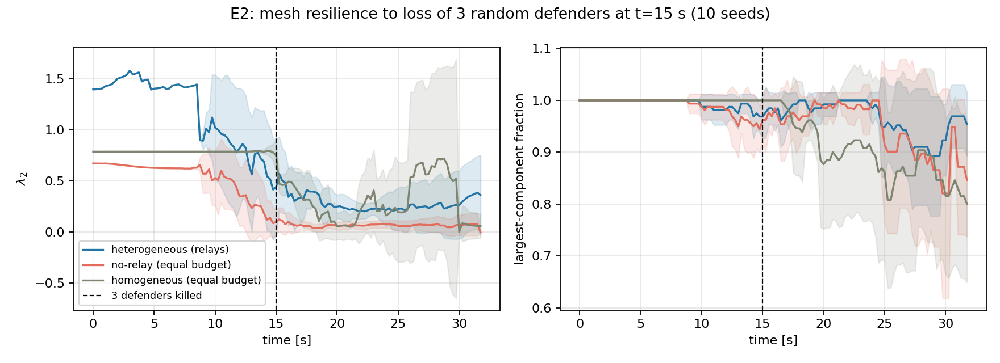
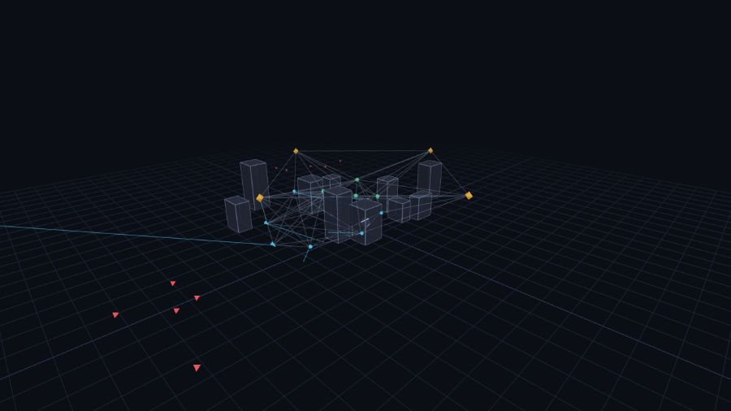

# Counter-Swarm — Heterogeneous 3D Counter-Drone Swarm Defense

A fully 3D simulation of a **heterogeneous drone swarm defending a site against an
evasive attacking swarm** — built to study one question: *when a team's own motion
constantly reshapes what it can see and say, what does each specialist role actually
buy you?*



*A 16-drone defense team (🟡 sentinels · 🔵 interceptors · 🟢 relays) versus 10
attackers (🔴) flying low among buildings. Grey lines are live radio links; flashes
are intercepts. Rendered from the included Three.js viewer.*

## The idea

Three problems that are usually studied separately are simulated **in closed loop**:

| Subsystem | What's modeled | Why it bites |
|---|---|---|
| **Seeing** | Cone/sphere sensor volumes with true 3D line-of-sight occlusion by buildings | Attackers terrain-mask: they fly low and blink in and out of view |
| **Talking** | Range- and LOS-limited radio links, per-message loss growing with distance | The network's shape changes every second as drones move |
| **Deciding** | Consensus auctions (CBBA, bundle size 1) that run *per connected component* | A cut-off drone bids on nothing — coordination rides on the mesh |

The defenders split three roles with genuinely different physics (not identical agents
with labels): slow high-flying **sentinels** carry the wide-area sensors, fast
fuel-limited **interceptors** chase with true 3D proportional navigation, and
**relays** climb the gradient of the network's algebraic connectivity (λ₂) to keep the
mesh in one piece. An interceptor that sprints 500 m after a target physically tears
the network that feeds it target updates — and the relays have to repair it mid-fight.

## Key results

Equal team size (16) in every condition, 10 seeds per data point:



- **Specialists detect earlier and intercept faster.** The heterogeneous team beats a
  same-size homogeneous "generalist" team on mean time-to-intercept at **every**
  attack size (20.4–22.5 s vs 22.7–23.7 s) with better track coverage throughout —
  despite the generalist team having twice as many sensor-carrying, intercept-capable
  aircraft. A generalist that chases stops sensing, tearing a hole in its own coverage.
- **Relays buy network margin, not kills.** Relays hold a consistent **2.3×
  algebraic-connectivity margin** over a no-relay team that spends the same four
  airframes on extra interceptors — but those extra interceptors win on raw
  interception rate at high load (0.89 vs 0.79 at 16 threats).



- **Attrition sharpens the trade-off.** After 3 of 16 defenders are destroyed
  mid-engagement, the relay team's connectivity margin grows to **4.5×** (λ₂ 0.27 vs
  0.06) and its mesh stays 97% intact — while the no-relay team still posts the best
  post-loss kill rate. **Effector capacity and information-flow margin compete for the
  same airframes**, and that trade-off is invisible unless allocation, sensing, and
  connectivity are simulated together. That coupling is the research gap this project
  targets: *heterogeneous role allocation under partial 3D observability and dynamic
  connectivity.*

## Quickstart

```bash
pip install numpy matplotlib
python run_sanity.py        # verification gate — run this first
python run_experiments.py   # E1 scaling + E2 node-loss -> results/results.json (~10 min)
python make_plots.py        # figures + printed summary table
python export_run.py        # record a demo run -> viewer/data.js
```

`run_sanity.py` checks the physics before you trust anything: 1v1 interception
convergence (straight and evasive targets), monotone mesh response to relay count,
occlusion measurably hiding low-flying threats, and runtime speed/acceleration bounds.

## 3D viewer



After `export_run.py`, open `viewer/index.html` in a browser (or serve it:
`python -m http.server --directory viewer`). Orbit/zoom with the mouse; play, pause,
scrub, and speed controls at the bottom; the HUD shows live agent counts and λ₂.

## How it works (short version)

- **Dynamics** — every aircraft is a 3D point mass with role-specific speed and
  acceleration caps, integrated at 50 ms. Interceptor fuel drains with speed².
- **Guidance** — assigned interceptors fly vector proportional navigation:
  `a = N·(Ω × v)` with `Ω = (r × v_rel)/|r|²`, i.e. steer until the line of sight
  stops rotating. Kill inside 6 m miss distance.
- **Allocation** — once per second, each connected component auctions its fused fresh
  tracks; bids are estimated time-to-go from closing geometry, gated by fuel, with
  hysteresis against churn. A second auction posts sentinels to lookout stations
  weighted by where the threats are.
- **Relay control** — gradient ascent on λ₂ via the Fiedler vector: each relay moves
  toward the seam where the network would tear first, or bridges the gap if it
  already has.
- **Threats** — spawn 750–900 m out in clusters, cruise at 15–35 m among the
  buildings, weave continuously, and jink hard away from any interceptor within 130 m.

## Repository layout

```
sim/            simulation core (config, world/LOS, comms/λ₂, guidance, allocation, engine)
run_sanity.py   verification gate
run_experiments.py, make_plots.py, export_run.py
viewer/         Three.js playback viewer (+ recorded demo run)
results/        experiment data, figures, demo media
paper/          LaTeX paper draft + figures (self-contained — upload to Overleaf as-is)
docs/design.md  scope & design decisions
OUTREACH.md     half-page plain-language summary
```

## Paper

[`paper/paper.tex`](paper/paper.tex) — problem statement, related work and gap, method,
experiments, results, limitations. The folder is Overleaf-ready (figures included,
local paths).
