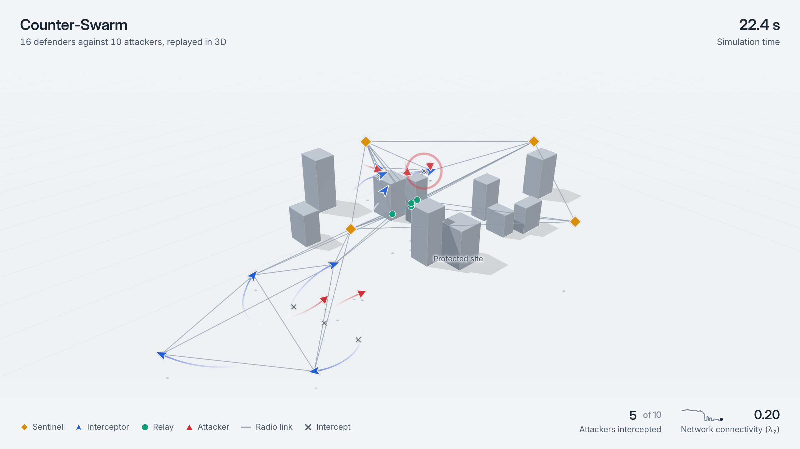

# Counter-Swarm

A 3D simulation of a heterogeneous drone team defending a site against an evasive
attacking swarm. It studies one question: when a team's own motion keeps changing
what it can see and who it can talk to, what does each specialist role contribute?


*16 defenders against 10 attackers flying low among buildings. Sentinels are amber
diamonds, interceptors blue arrows, relays green circles, and attackers red triangles.
Grey lines are radio links and crosses mark intercepts. [Full-resolution video](results/demo.mp4).*

## Overview

Three subproblems that are usually studied separately are simulated together, in
closed loop:

| Subsystem | Model | Effect |
|---|---|---|
| Sensing | Cone and sphere sensors with 3D line-of-sight occlusion by buildings | Low-flying attackers drop in and out of view |
| Communication | Range- and line-of-sight-limited radio links with distance-dependent loss | The network topology changes as drones move |
| Allocation | Consensus auctions (CBBA, bundle size 1) run within each connected component | A disconnected drone cannot take part in coordination |

The defenders have three roles with different flight characteristics:

- **Sentinels**: slow, high-altitude, carry the wide-area sensors.
- **Interceptors**: fast, fuel-limited, pursue targets with 3D proportional navigation.
- **Relays**: follow the gradient of the network's algebraic connectivity (λ₂) to keep
  the team connected.

An interceptor that chases a target far from the team can break the network that
supplies its target updates, and the relays have to repair it during the engagement.

## Results

All conditions use 16 defenders and 10 random seeds per data point. Baselines are a
no-relay team (4 sentinels, 12 interceptors) and a homogeneous team (16 identical
generalist drones).


- **Specialists intercept faster.** The heterogeneous team has a lower mean
  time-to-intercept than the homogeneous team at every attack size (20.4–22.5 s vs.
  22.7–23.7 s) and better track coverage throughout. The gap is clear at 4 and 8
  attackers (about 2.5 s) and narrower at 12 and 16 (about 1.2 s, not statistically
  significant at 10 seeds).
- **Relays improve connectivity, not interception rate.** Relays give about 2.3× the
  algebraic connectivity of the no-relay team. Spending those four airframes on extra
  interceptors instead yields a higher interception rate under heavy load (0.89 vs.
  0.79 at 16 attackers).


- **The trade-off holds under attrition.** After 3 of 16 defenders are destroyed
  mid-engagement, the relay team keeps 4.5× the connectivity of the no-relay team
  (λ₂ 0.27 vs. 0.06) and 97% of its network stays connected. The no-relay team still
  has the highest post-loss interception rate.

Interception capacity and network resilience compete for the same airframes. This
trade-off only appears when allocation, sensing, and connectivity are simulated
together.

## Quickstart

Requires Python 3 with NumPy and Matplotlib (`requirements.txt`); the tests also
need pytest (`requirements-dev.txt`).

```bash
pip install -r requirements-dev.txt
python -m pytest -q         # unit tests
python run_sanity.py        # verification checks; run first
python run_experiments.py   # experiments E1 and E2 -> results/results.json (~10 min)
python make_plots.py        # figures and summary table
python export_run.py        # record a demo run -> viewer/data.js
```

To re-render the demo GIF, video, and screenshot from the viewer (needs Node,
Playwright, and ffmpeg), run `node tools/render_media.mjs`.

`run_sanity.py` checks that a single interceptor converges on straight and evasive
targets, that network metrics improve with relay count, that buildings reduce
tracking of low-flying targets, and that speed and acceleration limits hold.

## 3D viewer



Serve the viewer with `python -m http.server --directory viewer` and open
`http://localhost:8000`. By default the camera follows the engagement; drag to orbit
and scroll to zoom, which switches to manual control. The control bar has play,
pause, speed, and a timeline. The overlay shows the intercept count and the network's
algebraic connectivity over time.

## How it works

- **Dynamics**: each aircraft is a 3D point mass with role-specific speed and
  acceleration limits, integrated at 50 ms steps. Interceptor fuel use scales with
  speed squared.
- **Guidance**: interceptors use vector proportional navigation,
  `a = N (Ω × v)` with `Ω = (r × v_rel) / |r|²`. A kill occurs within 6 m.
- **Allocation**: once per second, each connected group auctions its current tracks.
  Bids are estimated time-to-go, limited by fuel, with hysteresis to prevent constant
  reassignment. A second auction assigns sentinels to lookout stations near the
  threats.
- **Relay control**: gradient ascent on λ₂ using the Fiedler vector. Each relay moves
  toward the weakest point in the network, or bridges the gap if the network has
  already split.
- **Attackers**: spawn 750–900 m out in clusters, fly at 15–35 m altitude among the
  buildings, weave, and evade any interceptor within 130 m.

## Repository layout

```
sim/                 simulation core (config, world, comms, guidance, allocation, engine)
run_sanity.py        verification checks
run_experiments.py   experiments E1 and E2
make_plots.py        figures and summary table
export_run.py        demo recording for the viewer
viewer/              Three.js playback viewer and recorded demo
tools/               render_media.mjs: renders the demo GIF, video, and screenshot
results/             experiment data, figures, demo media
paper/               LaTeX paper and figures
docs/design.md       design decisions
```

## Paper

[`paper/paper.tex`](paper/paper.tex) covers the problem, related work, method,
experiments, results, and limitations. The folder is self-contained and compiles
as-is (for example, on Overleaf).
